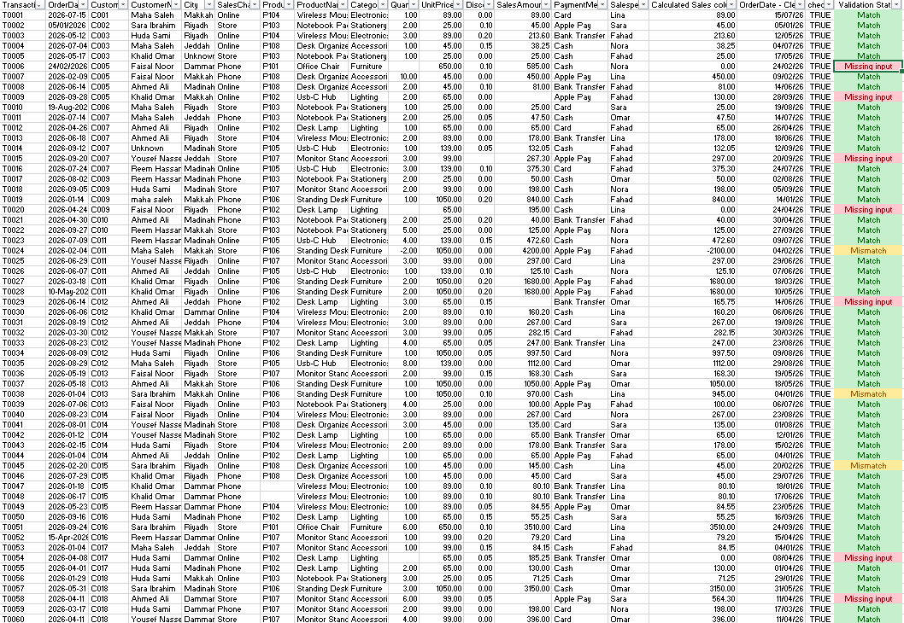
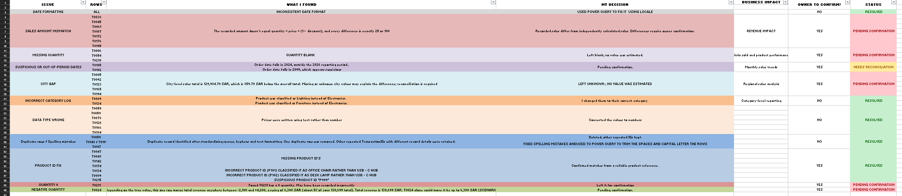
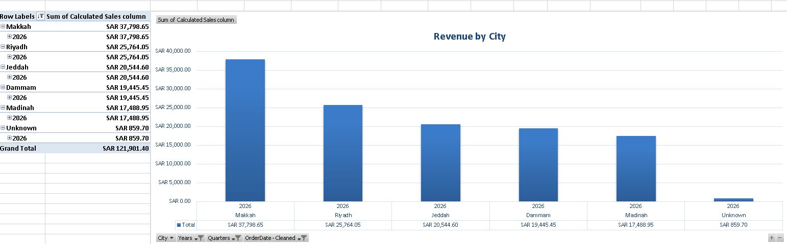
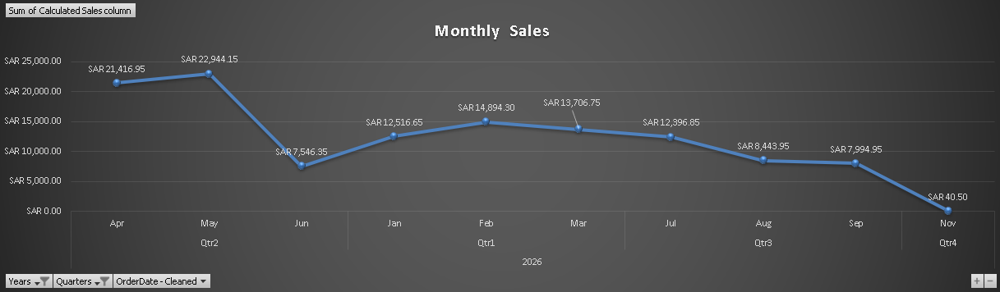
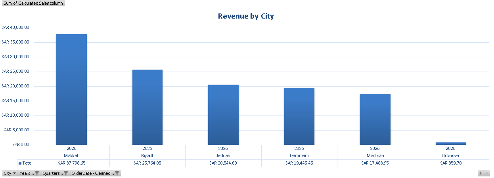
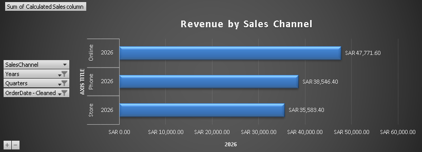
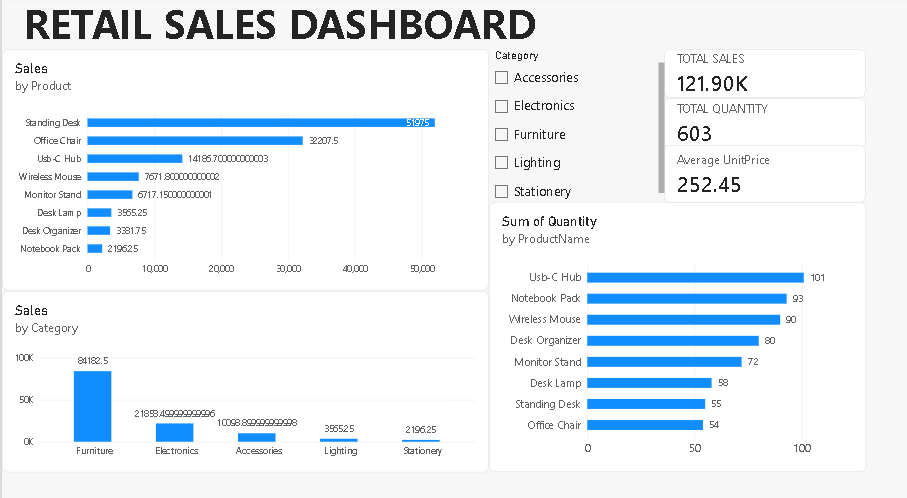
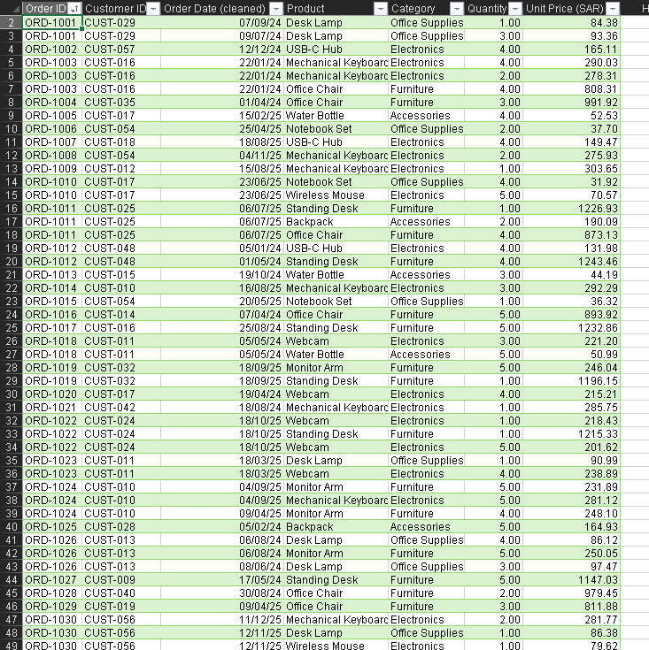

# AHMED MUSTEFA - DATA ANALYST PORTFOLIO 

 ## ABOUT ME
 
Hi, I'm Ahmed 👋

I'm an aspiring data analyst focused on turning raw data into meaningful business insights.

I'm developing practical skills in data cleaning, analysis, and visualization through hands-on projects using real-world business scenarios.

## TABLES OF CONTENTS

1. [About Me](#about-me)
   

2. [Education](#education)
   

4. [Projects](#projects)

   

5. [Contact](#contact)

### Education

**High School Diploma**  
Graduated: 2024

**Additional Learning**
- Self-directed learning in Data Analytics.
- Practical training in Excel, SQL, Power BI, and Power Query.
- Hands-on projects focused on retail sales and customer purchasing behavior.

### 🛠️ Technical Skills

- Excel: Data Cleaning, Formulas, PivotTables

- SQL: Joins, CTEs, Aggregations, Window Functions

- Power BI: Data Modelling, DAX, Interactive Dashboards
- Power Query: Data Transformation and Cleaning

 ### 🎯 Current level

- Improving SQL querying and analytical skills.
- Building business-focused data analytics projects.
- Developing interactive Power BI dashboards.

# Projects
### In this section I will list data analytics projects briefly describing the technology stack used to solve cases 

## Retail Sales Analysis

#### Description 

- The provided dataset contains raw retail sales records that may include missing customer information, inconsistent date formats, incomplete transaction details, and other data inconsistencies.

- Management needs a reliable view of business performance to understand which products generate the most revenue, how different cities and sales channels perform, and how sales change over time.

- The objective of this project is to investigate the raw data, identify and address data quality issues, and transform it into meaningful business insights using Excel, Power Query, and Power BI.

**FILES**:

#### EXCEL
[RAW/CLEANED DATASET](retail_data_analyst_first_jobPROJECT.xlsx)

#### POWER BI
[RETAIL_SALES_ANALYSIS](RETAIL_SALES_ANALYSIS.pbix)

#### Goal 
Transform messy retail sales data into a reliable dataset ready for analysis.

**Objectives**:

1. Identify and handle missing values.
2. Investigate inconsistent date formats and invalid dates.
3. Check duplicate records and data inconsistencies.
4. Standardize customer, product and location information.
5. Validate quantities, prices and sales amounts.
6. Prepare a clean dataset for business analysis.
   
Business question:

- Are there missing or inconsistent sales records?
- Are sales dates valid and reliable?
- Are product quantities and prices accurate?
- Can the dataset be trusted for reporting?
  
#### Skills Required 
Data Cleaning, Formulas, PivotTables , PivotCharts , Power BI dashboard

#### Technology
Excel . Power BI

#### Results

- Identified data quality issues involving inconsistent dates, missing customer information, and incomplete sales records. These issues require further investigation and data-quality improvements.

- Total recorded revenue was SAR 121,901.40.
- Furniture was the highest-revenue category at SAR 84,182.50. Stationery was the lowest at SAR 2,196.25.
- Standing Desk (P106) generated the most revenue at SAR 51,975.00. Notebook Pack (P103) generated the least at SAR 2,196.25.

- May 2026 was the highest-revenue month at SAR 22,944.15. November 2026 was the lowest at SAR 40.50, with one recorded order.

- Makkah had the highest revenue at SAR 37,798.65. Unknown had the lowest at SAR 859.70.

- The Online channel generated the most revenue at SAR 47,771.60. The Store channel generated the least at SAR 35,583.40.

- The total quantity generated 603 quantity. The average unit price is 252.45

- ### Business Recommendations
 
- #### Standing Desk revenue was much higher than Notebook Pack revenue, but revenue alone does not show whether a product is more profitable or whether the difference is driven by price or sales volume. Before making pricing or inventory decisions, management should:

1. Review profit margins by product and category. Higher revenue does not necessarily mean higher profit.
2. Compare units sold and average selling prices to understand whether Standing Desk’s higher revenue comes from selling more units, a higher price, or both.
3. Review inventory availability and turnover before changing stock allocation.
4. Investigate the data quality issues—especially inconsistent dates, missing customer information, and incomplete sales records—so future comparisons are more reliable.
## Repeat Purchase Analysis

**FILES**:

#### EXCEL
 

#### SQL

#### Description

The company wants to understand whether customers return to make additional purchases after their initial transaction.

However, before meaningful analysis can take place, the raw dataset needs to be investigated. It may contain missing information, inconsistent formats, and other data quality issues that could affect the reliability of the analysis.

**Management wants to understand**:
- How many customers make repeat purchases?
- How much do returning customers spend?
- How long does it take customers to purchase again?
- Which products are frequently purchased again?
- What proportion of customers return to make another purchase?
  
The purpose is to turn the raw transaction data into reliable information that helps management understand customer retention and purchasing behaviour.

#### Goal

Analyzing customer repeat purchasing behaviour using Excel, Power Query, and SQL. Investigating customer retention, purchase frequency, spending patterns, and product repurchases to uncover insights that support better business decisions.

**Objectives**:

1. Improve the quality and reliability of the customer transaction dataset.

2. Identify customers who make repeat purchases.

3. Examine customer spending and purchasing frequency.

4. Understand the time between a customer's purchases.

5. Identify products and patterns associated with repeat purchasing.
   
  
#### Excel — Data Cleaning & Preparation

**Objective**:

Prepare the raw repeat-purchase dataset for reliable analysis by identifying inconsistencies, correcting data formats, investigating missing values, and documenting every transformation.

1	Are there missing values in important columns?
2	Are customer IDs and transaction IDs consistently formatted?
3	Are purchase dates stored in a consistent date format?
4	Are there duplicate transaction records?
5	Are product names and categories consistent?
6	Are quantities and prices valid?
7	Are there any unusual or potentially invalid records?
8	Can the dataset be prepared for SQL analysis without losing important information?

**Documentation Requirements**:

- Record the original data quality issues.
- Document every cleaning transformation.
- Explain why each correction was necessary.
- Preserve the raw dataset separately.
- Export the cleaned dataset for SQL analysis.

#### SQL — Customer Behaviour & Repeat Purchase Analysis  

**SQL business question**

1	How many unique customers are in the dataset?

2	How many customers made more than one purchase?

3	What percentage of customers made repeat purchases?	

4	Which customers made the most purchases?	

5	How much did each customer spend in total?	

6	Which customers generated the highest revenue?	

7	How much time passes between a customer's purchases?	

8	Which products are purchased repeatedly?	

9	How does purchasing behaviour differ between first-time and returning customers?	

10	What percentage of total revenue comes from repeat customers?

#### Results

### Business Recommendations

#### Management should prioritize :

1. Customer retention because returning customers generate the vast majority of revenue

2. The business should also investigate ways to convert first-time buyers into repeat customers

### Contact

- Ahmedmustefa316@gmail.com
